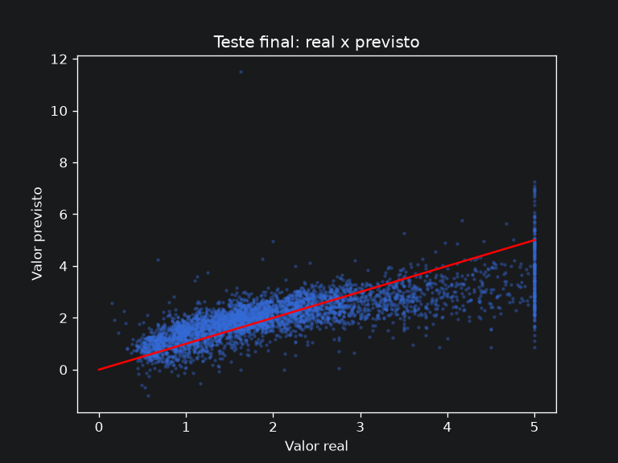

# Previsão do valor de casas na Califórnia com regressão linear

Projeto de Machine Learning feito do início ao fim: da análise dos dados até um modelo salvo que
prevê o valor das casas de um bairro.

**Tecnologias:** Python, pandas, scikit-learn, matplotlib, seaborn, Jupyter.

## Resultado

| Modelo | Erro médio (MAE) | RMSE | R² |
|---|---|---|---|
| Chutar sempre a média (referência) | US$ 90.600 | 1.145 | 0.00 |
| **Regressão linear** | **US$ 53.300** | **0.746** | **0.58** |

O modelo erra **41% menos** do que chutar a média e explica cerca de **58%** da variação dos preços.
Esses números vêm de dados que o modelo nunca viu durante o treino.



**Limitações:** o modelo erra mais nos bairros caros, porque os dados cortam os valores em
US$ 500 mil, e às vezes prevê valores impossíveis (negativos). Ele serve para entender tendências,
não para definir o preço de um imóvel.

## Os dados

O conjunto **California Housing** (censo dos EUA de 1990) tem **20.640 bairros**. Para cada um:

| Coluna | O que é |
|---|---|
| `MedInc` | renda média das famílias (em US$ 10 mil) |
| `HouseAge` | idade média das casas |
| `AveRooms` / `AveBedrms` | média de cômodos e de quartos por casa |
| `Population` / `AveOccup` | moradores no bairro e média por casa |
| `Latitude` / `Longitude` | localização |
| `MedHouseVal` | **o que queremos prever:** valor médio das casas (em US$ 100 mil) |

## Como o projeto foi feito

**1. Análise dos dados** (`notebooks/01_eda.ipynb`)
- Os dados estão completos (não há valores faltando).
- A **renda** é a variável mais ligada ao preço.
- Encontrei problemas: os preços estão **cortados em US$ 500 mil**, a idade das casas em 52 anos, e
  há bairros com valores absurdos (até 1.243 moradores por casa).

**2. Referência para comparar** (`notebooks/02_baseline.ipynb`)
- Antes de treinar, criei um "modelo" que sempre chuta o preço médio. Qualquer modelo útil precisa
  errar menos que ele.
- Separei 20% dos dados para o **teste final**, usado só uma vez, no fim.

**3. Modelo** (`notebooks/03_regressao.ipynb`)
- Comparei a regressão usando **só a renda** com a regressão usando **todas as colunas**:

  | Modelo | Erro médio |
  |---|---|
  | Só renda | US$ 63.100 |
  | **Todas as colunas** | **US$ 53.300** |

- **A descoberta mais interessante:** a localização parecia irrelevante na análise inicial, mas
  dentro do modelo é o que mais pesa. Bairros com a mesma renda valem mais perto do litoral.

**4. Teste final** (`notebooks/04_teste.ipynb`)
- Treinei o modelo escolhido e o avaliei **uma única vez** nos dados guardados (resultado acima).

**5. Modelo pronto para uso** (`treino.py` e `prever.py`)
- `treino.py` treina e salva o modelo. `prever.py` carrega o modelo e estima o valor de um bairro novo.
- Exemplo: um bairro em Los Angeles com renda de US$ 50 mil/ano → **US$ 249.848**.

## Como rodar

```bash
python -m venv .venv
source .venv/bin/activate
pip install -r requirements.txt
python treino.py    # treina e salva o modelo em models/
python prever.py    # prevê o valor de um bairro novo
```

## Estrutura

```
regressao-linear/
├── data/raw/              # dados originais
├── notebooks/             # análise e experimentos (01 a 04)
├── models/                # modelo treinado
├── reports/figures/       # gráficos
├── treino.py              # treina o modelo
├── prever.py              # usa o modelo
└── requirements.txt       # bibliotecas usadas
```

## O que aprendi

- **Analisar antes de modelar:** dados sem valores faltando ainda podem ter problemas escondidos,
  e foram justamente esses problemas que explicaram onde o modelo erra.
- **Sempre ter uma referência:** um número de erro só tem sentido comparado a algo simples.
- **Não "espiar" o teste:** comparei os modelos em uma parte separada dos dados e deixei o teste
  para o final, para ter um resultado honesto.
- **Uma correlação baixa não significa uma variável inútil:** a localização provou isso.
- **Testar em vez de achar:** cada dúvida virou um experimento medido.

## Próximos passos

- Criar variáveis novas, como a distância até Los Angeles e São Francisco.
- Usar validação cruzada para um resultado mais robusto.
- Comparar com modelos que capturam relações não lineares (por exemplo, Random Forest).
